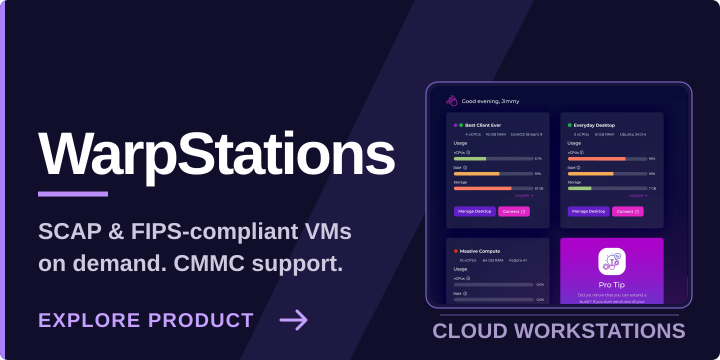

<!-- GitHub profile README for github.com/jacobglikz -->

  

<h2 align="center">Hi, I'm Jacob.</h2>

  I build internal platforms and developer tools at <a href="https://zetier.com"><strong>Zetier</strong></a>.

Most of Zetier's work isn't public. Here are two products you can actually check out:

<table>
  <tr>
    <td width="50%" valign="top">
      
    </td>
    <td width="50%" valign="top">
      
    </td>
  </tr>
</table>

More about the team and what we do → <a href="https://zetier.com"><strong>zetier.com</strong></a>
